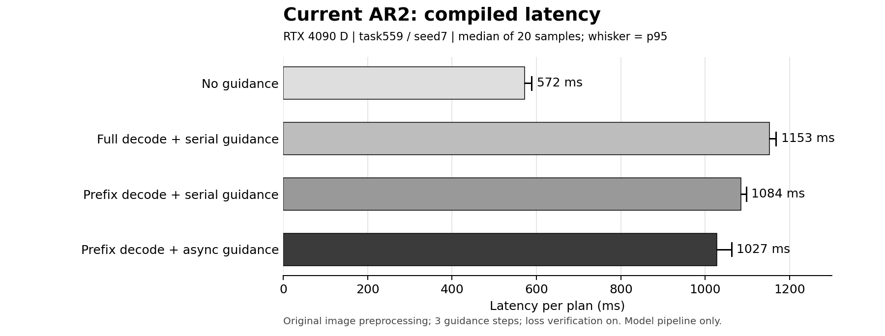

# 当前 AR2 编译与 latency 测试结果

2026-10-26 15:59 后台正常退出；已完成编译、120 次正式采样及两次独立 profiler 追踪。

## 与旧图的口径差异（补充更正）

本报告是当前加权AR2的调度对照，不是旧图原实验的复现。不能将1153ms称为旧图原始方案，也不能用1027ms与旧图680ms直接比较。

- 旧图680ms是576 + 40% × (837 − 576)的混合估计；本次1027ms是每次开启guidance的固定输入实测中位数，没有测试在线触发。
- 旧图包含约14ms预处理；本次从视频生成开始计时，最外层观测预处理未计入。
- 当前使用JEPA2.1 ViT-L384、两段AR2和任务加权L1、verify_descent=true；837ms对应实验的精确配置尚未完全找回，不能声称同模型、同loss或同核对配置。
- 本次full_serial是人为将编码也串行放在动作前的消融基准。旧图Action+JEPA一栏的具体内部调度尚未完整复核，不能把本次串行基准当成旧实际代码路径。原生首段推理时间虽留档，但不是20次稳态原生路径对照。
- 当前可成立的收益结论只限于本次构造的四条同模型编译路径：完整解码串行1153ms→前缀并行1027ms。尚不能称为相对旧系统的收益。

## 主要结果

| 方案 | 中位延迟 | p95 |
|---|---:|---:|
| 无 guidance | 571.7 ms | 588.5 ms |
| 完整解码＋串行 guidance | 1152.6 ms | 1167.5 ms |
| 前缀解码＋串行 guidance | 1084.2 ms | 1096.7 ms |
| 前缀解码＋并行 guidance | 1027.0 ms | 1062.1 ms |

完整解码串行 → 前缀解码并行：减少 125.5 ms（10.9%）。其中前缀解码贡献 68.4 ms；串行改并行再减少 57.1 ms。

## 瓶颈与资源竞争

1. 并行方案动作阶段跨度约 707.4 ms，包含动作去噪、guidance 和等待。其中 guidance 前向约 210.5 ms、反向约 129.6 ms；这部分约340ms，仍是明显开销。视频生成约 319.6 ms，也是主要开销。中位数与重叠阶段不能机械相加。
2. JEPA 编码在串行约 42.7 ms，并行约 47.3 ms，变慢约 10.7%；前缀解码约89.7→96.8ms，动作阶段跨度约613.1→707.4ms。说明并行会改变组件耗时，但总体仍省约57ms。这里同时存在 GPU 调度、内核和主机调度影响，不能仅凭这些时间认定是显存带宽饱和。
3. 首次 guidance 等编码的 GPU 事件跨度仅约 0.038 ms；JEPA 结果依赖等待不是主要瓶颈。这也不代表并行完全没有资源竞争。
4. 关闭 loss 下降核对的诊断组约 934.7 ms，比主方案少约 92.3 ms。仅量化这项诊断开销，正式配置仍保留核对。
5. Profiler 中主要热点包括矩阵乘法和注意力前后向。该追踪单独运行，不计入正式 latency；不能把嵌套算子和内核的时长重复相加，也不能据此证明 SM/DRAM 饱和。

后续优化应优先关注 guidance 多次前向/反向、loss 核对以及视频/动作模型计算。继续压缩单次 JEPA encoder 的收益空间相对有限；降低精度、TF32 或减少 guidance 次数均会改变实验条件，本次没有启用。

## 一致性及测试边界

- task559、seed7、固定初始图像和同一份 T5；没有新增任务 rollout。每次计划固定形状、guidance 节点7/8/9、scale4、RMS上限0.02、FP32 JEPA/AR2、原夹爪修复与加权 L1。
- 完整模型加载后：首段执行动作与历史结果完全一致；前缀与完整解码前三帧完全一致；GPU完整解码与原始解码像素完全一致；新旧注意力上下文的实际编码完全一致。
- 编译后的串行/并行动作逐元素完全一致。编译/未编译原始动作最大差异0.005859375、RMS0.0018803；因此不能声称编译后轨迹与既有成功率实验逐位一致，性能测试也不证明任务成功率不变。
- GPU 图像 resize/预处理探索组约1016.3ms，但动作最大差异0.00390625，未通过等价阈值；不纳入主方案提速结论。
- 主测试物理GPU7（进程中CUDA逻辑编号0），RTX4090D；不是Thor测量。正式计时阶段没有重编译。另有378MiB常驻进程，非严格独占GPU；5秒资源快照不能排除快照间其他负载。
- 时延范围为视频生成开始到动作生成完成，包含用于guidance的未来解码与图像预处理；不包含传感器采集、最外层观测预处理、仿真执行和视频录制。
- 没有实际测试40%触发率；旧图680ms是混合估计，不能作为本次实测值。本次使用当前JEPA2.1/AR2和加权方案，不能直接将旧图837ms与本次数字解释为同配置回归。

## 编译产物

- 本次隔离缓存共 8421 个文件，逻辑大小 284.7 MB。今天从空目录开始生成，修复后保留并复用已成功编译的部分；末次冷启动记录不等于全部从零编译总时长。
- 缓存服务器路径：`/data/pxchen/PACT-WAM/evaluate_results/ar2_compiled_latency_20261026/compiler_cache/`。
- 原始 trace：同目录 `compiled_async_trace.json`（约163MB，保留服务器）。
- 保存了完整源码快照、各阶段校验、冷启动记录、原始120次采样、编译计数和算子表；后续可在相同环境和形状下尝试缓存复用，仍需warmup。

## 本次修复

参数捕获保留原函数签名；首次参考调用前设置任务权重索引；前缀解码保留完整形状的conv2后仅提前结束decoder；旧SDPA上下文替换为相同后端设置的新接口，仅作用于本次进程。原始正式评测代码和已完成42场景结果没有修改。

## 与目标异步流程图的执行差别

源码复核：本次当前真实图像的JEPA编码没有与Video Gen重叠，而是在视频生成和前缀解码后，与未来图像一起编码。Predictor前向、反传和修正在主流guidance节点运行。未来Decode+JEPA与Action Gen重叠已实现；整张目标图并未完整实现。未来若把Predictor放在异步流，主流仍需等待当前动作对应的梯度，不能移除这一依赖。

对比旧图标注：无guidance576→572ms、视频316→320ms，前缀解码134→97ms、JEPA编码69→47ms；增加主要在动作+guidance主流跨度，旧图约500ms、本次707ms。同模型本次消融中，动作跨度串行613ms、异步707ms，增长94ms；包含GPU/CPU调度影响，不能全部认定为GPU资源争用。原CPU/PIL图像处理仍在主对照中。旧837ms的完整配置尚未恢复，无法将全部190ms差额做确定归因。
