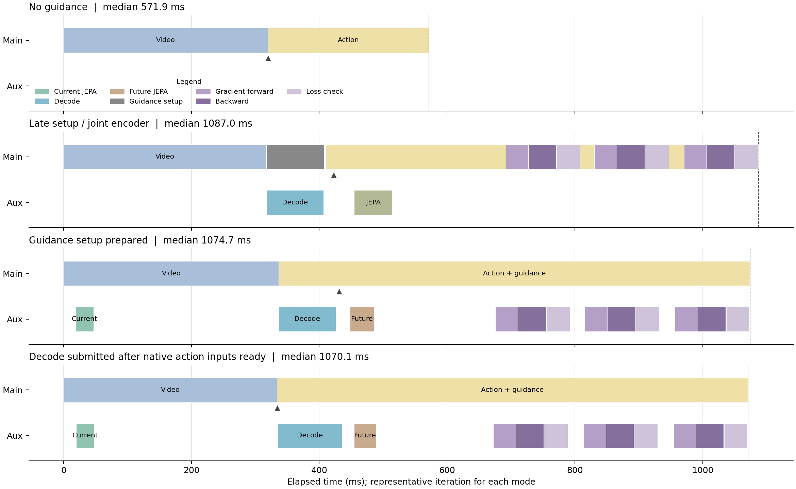

# 新编排逐组件延迟与阻塞排查（2026-10-27）

最终测试已完成：2026-10-27 12:24:23；GPU 5（NVIDIA GeForce RTX 4090 D）；4 组各 20 次，共 80 次稳态采样。另有 2 次 profiler 调用，不计入稳态结果。

## 同轮结果

| 方案 | 次数 | 中位数 ms | P95 ms |
|---|---:|---:|---:|
| 无 guidance | 20 | 571.95 | 588.29 |
| 排查对照：晚准备、合并编码 | 20 | 1087.00 | 1105.60 |
| 只前移 guidance 准备 | 20 | 1074.68 | 1094.67 |
| 最终方案：输入准备后并发 Decode / Action | 20 | 1070.06 | 1094.51 |

“排查对照”保留了本轮发现的晚准备/拷贝阻塞，用于定位问题。它不是此前 1027ms 测试的一比一复现，不能据此宣称相对原系统的总体提速。此前 837ms 的完整配置未恢复，本轮不能直接与其比较。

## 实际编排

1. 在完整计时范围内先构造 guidance，避免其同步 H2D 拷贝挡住后续并发。
2. 主流生成视频；辅助线程处理并编码当前图像。
3. 主流沿用原生随机动作生成和输入拷贝；在动作侧输入 VAE 编码入口提交辅助 Decode，随后两条流执行实际计算。
4. 辅助流继续未来图转换、CPU/PIL 处理、未来 JEPA 编码。
5. 去噪第 7/8/9 节点上，辅助流完成 Predictor 前向/反向；主流等待梯度并修正，之后继续去噪。下降核对仍开启。

图里的 Predictor 若画成“未来 JEPA 后紧接一整块”，实际还有动作依赖：必须等相应去噪节点的动作就绪，所以时间线上是后段三组前向/反向/核对，不能在未来编码完成后提前一次做完。

最终方案 Decode 与 Action 阶段重叠中位数 102.78ms；动作侧输入 VAE 起点相对 Decode 起点为 -1.30ms。后者用于辨别“进入 Action 函数”与“实际动作计算开始”。

图用各模式中总耗时最接近中位数的一次真实迭代绘制，不能把不同组件的中位数拼成一条时间线。三角标记表示动作侧输入 VAE 开始。Action 色带包含初始化和等待，不表示全程 GPU 忙碌。

## 最终方案的组件时间

| 组件 | 中位数 ms | 口径 |
|---|---:|---|
| guidance 准备 | 0.47 | host 调用跨度 |
| 当前图 CPU 处理 | 13.59 | host 调用跨度 |
| 当前图 JEPA 编码 | 28.71 | CUDA 事件跨度 |
| Video Gen 总跨度 | 335.18 | CUDA 事件跨度 |
| 前缀 VAE Decode | 102.78 | CUDA 事件跨度 |
| 未来图 .cpu() 调用，含等待 | 70.72 | host 调用跨度 |
| 未来图 PIL 处理 | 17.83 | host 调用跨度 |
| 未来图 JEPA 编码 | 32.80 | CUDA 事件跨度 |
| 动作侧输入 VAE 编码 | 13.50 | CUDA 事件跨度 |
| 视频 cache prefill | 127.22 | CUDA 事件跨度 |
| 10 次动作去噪合计 | 239.79 | CUDA 事件跨度 |
| 3 次 guidance 梯度前向合计 | 105.51 | CUDA 事件跨度 |
| 3 次 guidance 反向合计 | 129.86 | CUDA 事件跨度 |
| 3 次下降核对前向合计 | 109.89 | CUDA 事件跨度 |
| Action Gen 总跨度（含等待） | 735.34 | CUDA 事件跨度 |

父子区间与两条流存在重叠，表中数字不能相加。CUDA 事件跨度包含排队、同步和 host 发射空档，并非纯内核算时；host 调用跨度也包含等待。`.cpu()` 的 host 时间包含等待先前 Decode 完成，不能把它全部解释成 PCIe 传输。Predictor 前向包括 AR2 的 P1、P2 和加权 loss，未进一步分拆两次预测。

## 瓶颈判断

1. 三个节点的梯度前向、反向、下降核对共约 345.26ms；主流必须等待其结果，放到另一条流也不能越过这条依赖。当前显式梯度等待跨度为 346.16ms，和上述合计接近，属于主路径开销。
2. 真正并发后，视频 cache prefill 从无 guidance 的 28.29ms 增到 127.22ms。它与 Decode、未来 JEPA 编码重叠，是剩余最明确的并发慢化位置。其 host 调用也约 129.38ms；现有数据不能把全部慢化归结为 GPU 算力或显存带宽，host 发射、同步也在其中。
3. 提前当前图编码时，Video Gen 从 320.50ms 增到 335.18ms。它有重叠收益，也有约 14.69ms 的视频阶段慢化。第一个 guidance 的编码就绪等待只有 0.0338ms，编码未就绪不是这里的主要阻塞。
4. 最终 Decode 与动作侧 VAE 已实际重叠，但不能把整段 Decode 耗时直接从总延迟扣掉：被重叠的其他阶段也变慢了。后续若优化，应优先针对 prefill 与解码/图像拷贝的交互，以及 guidance 的串行前后向开销，而非只继续增加 stream。

## 已核实与限制

- 固定 task559、seed7、同一观测、同一份 T5、同一白杯任务权重。WAM BF16，JEPA/Predictor FP32；guidance 节点 7/8/9、scale4、RMS 上限0.02、下降核对开启。
- 原生首轮执行命令与历史记录完全一致；不同编排的热身动作最大差为 0。
- 辅助流梯度最大差 0，夹爪梯度为 0；校验阈值沿用 1e-5。
- 正式测量前后全部编译计数一致，10 个 unique graphs 无新增。热身补编译不计入稳态。
- 全部源码快照 SHA256 核对通过；逐次阶段数量核对通过。
- 活跃张量峰值 16505.31MiB，缓存保留峰值 18992.00MiB。
- 正式计时区间资源采样中的同卡其他进程：{"2168995": ["346 MiB"]}。采样间隔5秒，不能证明每个时刻独占，也不能单凭常驻显存判断对方计算强度。测试结束后该进程增至23346MiB，不属于本轮测量区间。
- 测量覆盖模型流水线及 JEPA 图像处理，包含 guidance 准备；不覆盖传感器、最外层 WAM 观测处理、环境执行或录像。这不是任务成功率实验；末尾原生评估器的 `0/1` 是 benchmark 提前返回的占位输出。

原始数据：`latency_samples.jsonl`；汇总：`latency_summary.json`；审计：`timing_audit.json`；编排/梯度校验：`scheduling_validation.json` 与 `aux_gradient_validation.json`；GPU/进程记录：`gpu_resource_samples.jsonl`；完整 trace 位于同名服务器目录的 `requested_async_trace.json`。
