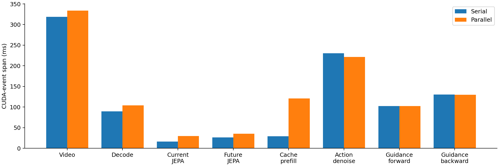
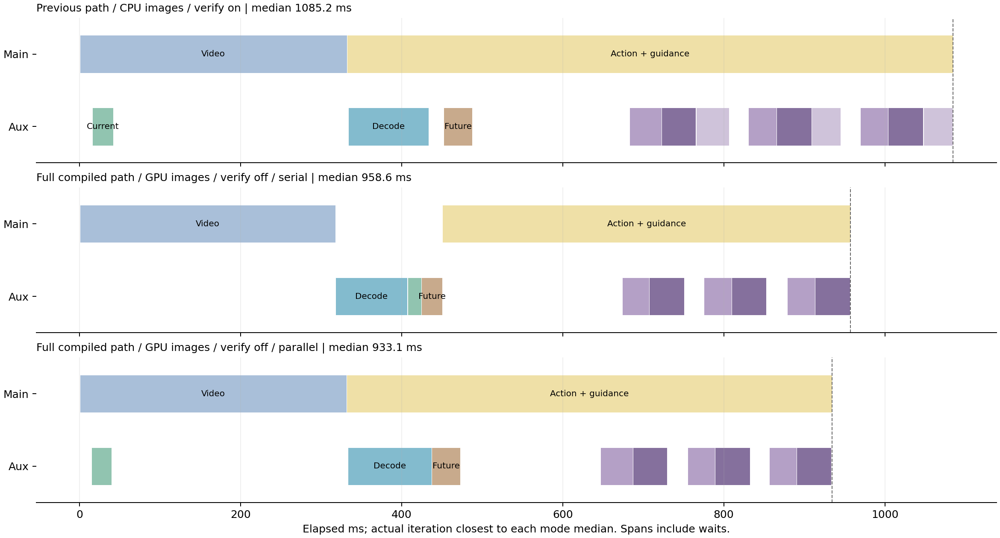

# 整段编译修正与竞争记录（2026-10-27）

状态：完成，2026-10-27 14:50:57，GPU 7。六组各20次，共120次稳态采样。模型仍为当前JEPA2.1 ViT-L384与AR2 step19690，未回退到旧vitg。

## 同轮结果

| 方案 | 次数 | 中位数 ms | P95 ms |
|---|---:|---:|---:|
| 无 guidance | 20 | 590.73 | 621.31 |
| 原路径：CPU 图像、核对开启 | 20 | 1085.16 | 1098.10 |
| 整段编译：CPU 图像、核对开启 | 20 | 1081.53 | 1126.07 |
| 整段编译：GPU 图像、核对开启 | 20 | 1041.11 | 1071.67 |
| 新配置：核对关闭、串行 | 20 | 958.60 | 997.58 |
| 新配置：核对关闭、并行 | 20 | 933.11 | 962.16 |

## 修正范围

- 整段编译 clean action反归一化、GPU执行夹爪、RawAdapter状态接入、AR2 P1/P2及加权loss；其反向由AOTAutograd编译。不再在每次guidance时把动作拷回CPU获取夹爪。
- 全部核心模型计算路径继续编译：视频去噪、动作去噪、prefill、VAE输入编码和前缀Decode、当前/未来JEPA。
- 未来图像转uint8、bicubic resize到384、归一化与pair组合留在GPU上，并编译该处理函数；保留CPU/PIL处理的单独对照。
- 新配置关闭下降核对，以对齐找回的837ms实验。其余对照保留核对，用于量化开销。下降核对在原实现中仅记录诊断，不改变修正是否执行；本轮核对开关动作差为 0。
- 使用修复后的并发提交点：原生动作输入准备完成后，同时开始动作侧VAE与辅助Decode；当前JEPA与Video Gen重叠；辅助流Predictor根据7/8/9节点动作执行，主流保留梯度依赖。
- CUDA Graph仍关闭。旧日志明确显示其energy CUDA Graph因CPU tensor被跳过；不能把旧版更快归因于必然使用了CUDA Graph。外层Python调度、显式流依赖及安全检查仍有图外逻辑，不宣称整个控制流程成为一个完整CUDA Graph。

## 分步收益

以下为同轮中位数之差，正数表示后者更快。各处理差异已明确标注，不能机械相加，也不能全部解释为单一机制。

| 对照 | 减少 ms |
|---|---:|
| 原路径→整段编译并取消CPU动作往返，均CPU图像/核对开启 | 3.63 |
| CPU未来图→GPU未来图，均整段编译/核对开启 | 40.42 |
| 开启核对→关闭核对，均GPU未来图/整段编译/并行 | 108.00 |
| 相同新配置串行→并行 | 25.49 |

GPU图像路径相对PIL参考的输入tensor最大差为 0.0350140333176，是否逐元素等价：False。其最终归一化动作相对PIL参考最大差为 0.00390625，RMS为 0.000702461577021。整段编译但仍用PIL时，动作相对原路径最大差为 0。GPU图像是显式处理变更，不把它混同为纯编译提速，也不据此证明原30/30/34成功率保持不变。串行/并行最终对照使用相同GPU处理，动作最大差 0。

## 并发竞争：相同新配置的串行与并行

| 组件 | 串行 ms | 并行 ms | 并行/串行 |
|---|---:|---:|---:|
| Video Gen | 318.79 | 333.65 | 1.047 |
| 当前 JEPA | 16.16 | 29.90 | 1.850 |
| 前缀 Decode | 89.49 | 103.83 | 1.160 |
| 未来 JEPA | 26.34 | 35.35 | 1.342 |
| 视频 cache prefill | 29.06 | 120.89 | 4.160 |
| 10步动作去噪合计 | 230.63 | 221.63 | 0.961 |
| 3次完整 guidance 前向合计 | 102.60 | 102.61 | 1.000 |
| 3次反向合计 | 130.11 | 129.58 | 0.996 |

这些是CUDA事件跨度，包含GPU排队、同步及主机发射空档，不等于纯kernel忙碌时间。prefill与Decode/编码重叠时的跨度变化能定位并发慢化位置，不能单凭它认定SM或DRAM带宽饱和。父子阶段与两条流重叠，表内数字不能相加得到总延迟。

独立的两次profiler中，prefill kernel执行时间合计分别为 46.42/49.73ms，但从首kernel到末kernel跨度为 118.11/119.80ms。约 69.71/68.19ms 的间隔中，下一个prefill kernel已经由CPU提交，同时辅助流kernel在运行。这表明仅靠把CPU发射提前并不足以消除GPU流间等待。它支持内部调度/资源竞争的判断，仍不能单独区分SM、带宽或其他具体硬件限制。两次profiler不计入120次稳态样本；详细关联见 `profile_stream_contention.json`，不能拿profile的kernel耗时直接替换稳态计时。

每行采用最接近该模式中位数的一次真实迭代，不用不同组件的中位数拼图。Action色带含等待，紫色依次为guidance前向、反向及（如启用）核对。

## 外部负载与CPU活动

| 方案 | 资源采样数 | GPU利用率均值 % | 显存控制器利用率均值 % | 进程CPU均值 % | 同卡其他计算进程及显存 |
|---|---:|---:|---:|---:|---|
| 无 guidance | 14 | 83.1 | 30.7 | 97.8 | {} |
| 原路径：CPU 图像、核对开启 | 20 | 64.7 | 31.4 | 113.0 | {} |
| 整段编译：CPU 图像、核对开启 | 20 | 73.8 | 27.4 | 121.8 | {} |
| 整段编译：GPU 图像、核对开启 | 21 | 82.3 | 31.4 | 108.6 | {} |
| 新配置：核对关闭、串行 | 20 | 89.4 | 33.2 | 107.3 | {} |
| 新配置：核对关闭、并行 | 19 | 82.0 | 34.9 | 118.5 | {} |

资源采样按每次迭代的Unix起止时间归组，排除热身及进程退出后的其他任务。目标采样间隔1秒，实际间隔和采集成本逐条保留。设备利用率有自身统计窗口，短迭代间可能混合相邻模式，表内均值只作为背景负载参考。原始记录还含功耗、温度、SM/显存频率、主/辅助线程CPU、主线程上下文切换和主机负载。pmon若返回`-`则表示进程级利用率不可用，不当作0。设备利用率不等于SM占用率；显存控制器利用率不等于已经测得带宽吞吐量。CPU百分比按进程/线程采样计算，100%约为一个逻辑核。

## 校验与边界

- 同一task559、seed7、观测、T5及任务权重；原生历史首执行命令通过精确核对。
- 2080个GPU夹爪边界案例最大差0.0，实际guidance夹爪命令核对通过，夹爪梯度为0。
- 整段编译loss/梯度与相同特征下原生路径、eager完整路径比较，误差均小于1e-5，详见`full_path_validation.json`。
- 正式测量编译计数前后完全相同，无稳态重编译。源码快照SHA、逐组件次数均已检查。
- 本轮是固定输入latency测试，包含模型流水线和当前/未来JEPA处理；不含传感器、最外层WAM观测处理、仿真执行和录像。末尾评估器`0/1`是benchmark提前返回的占位，不是成功率结果。
- 旧837ms为task365连续rollout下的13轮、旧vitg模型、无核对、不同预处理和夹爪实现。本轮复用其优化方式，不宣称同模型同输入复现旧数值。

文件入口：`latency_samples.jsonl`逐次完整时间线；`competition_samples.jsonl`竞争原始记录；`timing_competition_audit.json`审计；`latency_summary.json`汇总；`source_snapshot/`运行源码。完整profiler另保存在服务器同名目录`requested_async_trace.json`，不计入120次采样。
