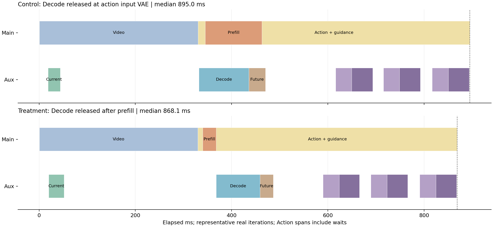

# prefill优先单变量对照（2026-10-27）

完成时间：2026-10-27 16:59:48；GPU 7。三组各20次，共60次固定输入计划，无新增环境成功率rollout。

## 改了什么

保持task559、seed7、初始观测、T5、权重、FP32 JEPA/AR2、BF16 WAM、GPU未来图处理、整段action-to-energy编译、guidance节点7/8/9及关闭下降核对全部相同。当前JEPA启动时机也保持相同。

唯一调度改变：对照在动作侧输入VAE入口提交Decode；处理组在prefill返回后记录主流CUDA事件，辅助流显式等待该事件，才开始Decode。随后Decode/未来JEPA与动作去噪重叠。

## 结果

| 模式 | 总中位数 ms | P95 ms | prefill跨度 ms | 10步动作去噪合计 ms | 首次guidance特征未就绪等待 ms |
|---|---:|---:|---:|---:|---:|
| 无 guidance | 562.36 | 570.09 | 28.05 | 204.01 | 0.0000 |
| 原并行：Decode 与动作输入编码同时启动 | 895.01 | 913.24 | 118.48 | 194.89 | 0.0000 |
| prefill 优先：完成后才放行 Decode | 868.15 | 886.40 | 28.07 | 263.84 | 0.0000 |

本轮总中位数变化：26.86ms（正数为prefill优先更快）。逐轮配对差的中位数为30.92ms；探索性bootstrap 95%区间为[23.367305286228657, 36.283547058701515]ms。以同轮对照为准，不与上一轮933ms直接拼接计算收益。

动作去噪合计用于识别等待是否从prefill转移到去噪计算；首次guidance的等待用“编码就绪CUDA事件－该节点动作就绪CUDA事件”的正部测量，用来识别延迟是否转移到guidance。



## 校验

- 每一条正式采样均保存完整原始动作SHA256；两个guided模式全部40次动作只有同一个哈希，调度未改变动作。
- prefill优先模式每次采样都验证Decode在prefill结束之后开始，允许计时分辨率0.01ms以内误差。
- 两个guided模式prefill/Decode重叠中位数分别为90.4279/0.0000ms。
- loss/梯度及2080个夹爪边界案例检查通过，夹爪梯度为0，正式采样没有重编译，源码SHA检查通过。
- GPU图像处理沿用上一轮方案，相对PIL的动作数值差此前已记录；这里比较的是相同GPU处理之间的调度，不把两者说成PIL逐元素等价。

## 竞争记录

按正式采样的Unix起止时间过滤资源日志，结果为：

```json
{
  "no_guidance": {
    "samples": 10,
    "gpu_util_pct": 81.9,
    "sm_clock_mhz": 2629.5,
    "other_processes": {},
    "errors": []
  },
  "full_gpu_verify0_async": {
    "samples": 19,
    "gpu_util_pct": 79.26315789473684,
    "sm_clock_mhz": 2578.0526315789475,
    "other_processes": {},
    "errors": []
  },
  "full_gpu_verify0_prefill_first": {
    "samples": 18,
    "gpu_util_pct": 87.05555555555556,
    "sm_clock_mhz": 2620.0,
    "other_processes": {},
    "errors": []
  }
}
```

原始日志还记录显存控制器利用率、功耗、频率、主/辅助CPU线程活动及上下文切换。约1秒采样可能混合相邻模式，仅作背景参考。CUDA跨度包含排队与host发射空档，不等于纯kernel忙碌时间，也不能单凭它认定SM/带宽饱和。

新旧两个guided模式均另做2次profiler，不计入正式采样。`profile_iterations.json`保存逐阶段CUDA/host区间，`requested_async_trace.json`保存在服务器，可用于检查GPU排队。

## 既有trace的补充定位

上一轮trace里，约68–70ms的已提交prefill计算等待期间，至少约45ms与辅助流BF16卷积重叠。这些卷积属于Decode；其余包括矩阵乘、attention及其他操作，未在缺少明确阶段标记时全部硬归为JEPA。原记录保存在`previous_profile_gap_kernel_names.json`。

关键入口：`latency_summary.json`、`latency_samples.jsonl`、`prefill_priority_audit.json`、`measured_action_hashes.json`、`competition_samples.jsonl`和`source_snapshot/`。这仍是模型流水线latency测试，不含传感器、最外层WAM观测处理、仿真执行或录像；末尾评估器0/1不是任务成功率。
